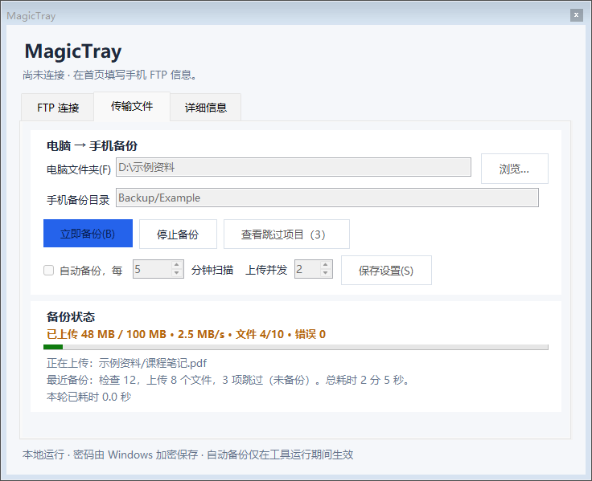
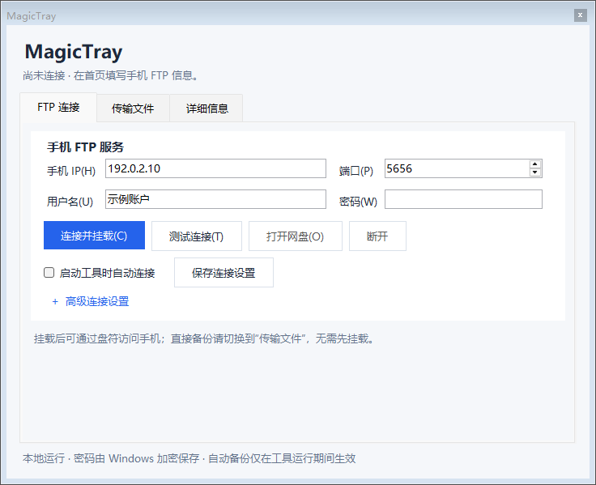
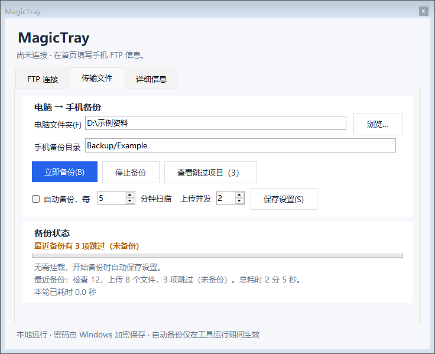
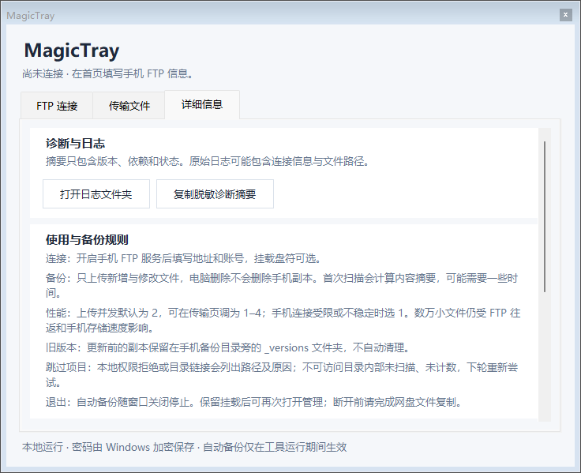

# MagicTray 2.2.2

一个本地运行的 Windows 手机 FTP 网盘与备份工具，使用 C# / WinForms / .NET Framework 构建。

**AI 制作声明：本项目由 DeepSeek 与 OpenAI Codex 协作制作和完善，用户主导需求、测试与验收。** 程序不依赖 AI API。

## 2.2.2 日常使用改进

- “详细信息”页顶部可打开日志文件夹，方便查看历史故障。
- “复制脱敏诊断摘要”只复制版本、运行时、依赖是否找到、完整性及操作状态等白名单信息，不含 IP、账号、密码、文件路径或原始日志；不会发起 FTP 测试或保存配置。原始日志仍可能包含连接信息和文件路径，分享前应自行检查。
- 传输页每秒显示本轮已耗时，包含本地摘要扫描和等待服务器的时间。成功、部分完成、失败和停止均保留总耗时，最近结果重启后仍可查看。

## 2.2 修复：文件已到手机却显示“备份失败”

旧逻辑只看 rclone 的退出码，无法区分已完成文件与剩余失败项：rclone 在文件已经写入手机后，仍可能因为控制连接被 Android 的 FTPShare 断开、旧版本改名、并发建目录或清理临时文件而返回非 0。旧版随即把整轮标成失败，并且不保存扫描记录，下一轮又把全部文件重传一遍。

2.2 的改动：

- 按对象读取 rclone 的 `Copied` 日志，先确认真正成功的文件；退出码非 0 时只重试未完成的文件。
- 重试自动降为单路并发；只有明确的 550/553 临时改名拒绝才切换 `--inplace`，普通网络错误不会直接覆盖正式文件名。
- 优先按每个对象的成功日志确认；仍未确认的文件可核对手机端实际大小。大小相同不等于内容已验证：仅大小核对的文件会在下一轮重新上传确认。
- 部分成功也会把“已确认文件”写入扫描记录，下一轮只补剩余文件；彻底失败则不写记录。
- FTP 连接、建目录、列清单增加有限重试；上传前若目标目录因并发 MKD 竞争未建成，会先重试建目录再列清单。
- 2.2.1 为本工具上传的临时文件使用专属后缀，只清理当前源所对应的临时项；历史不明 `.partial` 和用户同名文件会保留。
- 2.2.1 写入本地状态时保留原文件与回滚路径，写入失败不会先删除已有记录。
- 默认上传并发仍为 2；失败后按单路重试，避免手机 FTP 连接被进一步压垮。



## 三页界面

默认窗口为 720 × 560，顶部连接状态跨页可见，小窗口中的长内容可纵向滚动。使用鼠标页签、`Ctrl+Tab` 或 `Ctrl+1 / 2 / 3` 切换页面。

### FTP 连接

填写手机 FTP 服务的地址、端口、账号和密码，测试登录或挂载磁盘。“高级连接设置”可修改手机根目录、盘符和 rclone 路径。



### 传输文件

电脑 → 手机增量备份，无需先挂载。选择本地文件夹并填写手机备份目录，然后点击“立即备份”；开始时会自动保存设置。支持定时扫描、进度、停止和完整跳过报告。



传输中的示例：[查看模拟进度截图](docs/ui-transfer.png)。

### 详细信息

打开日志文件夹、复制脱敏诊断摘要，或查看使用与备份规则、依赖下载、隐私与 AI 制作说明。按需展开运行日志。



## 环境与依赖

- Windows 10 / 11 与 [.NET Framework 4.x](https://learn.microsoft.com/en-us/dotnet/framework/install/on-windows-and-server)。
- [rclone 官方下载](https://rclone.org/downloads/)：解压 Windows 版本后在首页高级设置选择 `rclone.exe`，也可放在程序目录、`tools` 子目录或加入 PATH。
- 需要挂载磁盘时安装 [WinFsp](https://winfsp.dev/rel/)；仅备份无需挂载。
- 手机需要启用可登录、可读写的 FTP 服务，电脑与手机能够互相访问。FTP 使用明文连接，适合可信局域网。

依赖需自行安装，仓库不附带第三方安装包。

## 快速开始

1. 双击 `MagicTray.exe` 或 `启动MagicTray.cmd`。首次启动不会自动连接。
2. 在“FTP 连接”页填写 IP / 主机名（不带 `ftp://`）、端口、用户名和密码。测试或连接会保存设置，也可单独点击“保存连接设置”。
3. 需要盘符时点击“连接并挂载”，再点击“打开网盘”。盘符默认为 `Z:`；已挂载时先断开再修改连接字段。勾选“启动工具时自动连接”后保存，下次启动生效。
4. 在“传输文件”页选择电脑文件夹、填写手机备份目录，点击“立即备份”。手机目录相对于 FTP 账号下设置的“手机根目录”，默认是 `/` 下的 `Backup/PC`。
5. 自动备份：勾选并设置 1–1440 分钟间隔，点击“保存设置”。每轮结束后安排下一轮，仅在工具运行期间有效。停止备份也会关闭自动备份。
6. 本地访问权限拒绝等项目会跳过并列出原因。点击“查看跳过项目”可查看完整路径；目录无法读取时只计该目录 1 项，内部未扫描、未计数。恢复权限后下一轮重新尝试。

配置保存在程序旁的 `MagicTray.ini`，运行日志与状态保存在 `logs/`。程序需要对所在目录有写权限。密码由 Windows DPAPI 加密，仅当前 Windows 用户可解密，换电脑或用户后重新输入。配置、日志和凭据不要提交到仓库。

## 小文件性能

“传输文件”页的“上传并发”默认为 **2**，可设置 **1–4**，点击“保存设置”或“立即备份”生效。该值同时用于文件上传与检查；它表示并行文件数，不是 FTP 总连接数。手机 FTP 连接受限、断连或超时时，可回调为 1。不会自动不断提高并发重试。

数万小文件需要大量 FTP 命令与数据连接，总容量相同也可能比少量大文件慢很多。实际速度受手机 FTP 实现、目录数量、手机存储与 Wi-Fi 状态影响。并发优化没有在用户手机上实测，不保证特定提速比例。[本机合成对照与验证记录](docs/performance.md)仅用于验证可控条件下的行为。

每轮仍完整读取本地文件计算 SHA-256，保留同大小、同修改时间的内容变化检测；没有改为只按大小/时间跳过读取。也继续列举手机端当前备份，检查缺失与大小异常。运行日志会记录连接、本地摘要、远端清单、上传/重试及总耗时，方便判断耗时阶段。

## 备份与退出规则

- 按本地文件内容摘要检测新增和修改，检查手机副本是否缺失或大小异常；电脑删除不会删除手机已有副本。
- 更新前的文件保留在手机备份目录旁的 `_versions` 目录，例如 `Backup/PC_versions/`，不自动清理。
- 明确以 550/553 拒绝上传临时文件改名的手机 FTP 服务会切换直接写入兼容模式；普通断线只用临时文件+改名重试，避免留下写了一半的正式文件。
- 每轮确认成功的文件会写入本机扫描记录；中途断线后下一轮只补剩余文件，不会把整轮重传。彻底失败时不写记录。
- 不复制目录链接、符号链接和空目录。源路径及其祖先目录不能是 junction 或符号链接；不允许备份工具自身目录及其上级、子目录，避免通过目录别名上传凭据和日志。
- 备份没有下载手机副本逐字节校验；手机上人为修改了文件但大小相同的情况，可能需要删除该副本后重新备份。
- 初次扫描大文件可能耗时。中断后的文件在下轮重新检查，大文件可能从头上传。
- 退出时可选择保留挂载，下次启动会识别本工具保留的挂载；定时备份随窗口退出停止。断开前完成磁盘文件复制。
- 工具仅管理自己创建并核验归属的挂载进程，不终止其他 rclone 作业。

## 常见问题：Rclone 报错但文件已在手机

先确认手机上的 FTPShare 仍在运行（通知栏常驻、WakeLock 开启）。Android 省电或 Wi-Fi 休眠可能让 FTP 服务在传输中途停止，表现为大量 `EOF`、`wsasend/wsarecv`、`connection refused`。MagicTray 2.2 会把已确认写入的文件保留在进度记录中；重启 FTPShare 后再次点击“立即备份”，只会补剩余文件，不会整轮重传。

若界面显示“部分完成/未完成”，展开“详细信息 → 运行日志”查看实际错误对象和计数；手机端对应目录旁的 `_versions` 保留旧副本。本工具只清理当前备份源所对应的专属临时项，历史不明 `.partial` 不自动删除。不要把 `logs` 目录或 `MagicTray.ini` 提交到仓库。

## 编译

从仓库根目录，在 Windows PowerShell 5.1 中执行：

```powershell
powershell -NoProfile -ExecutionPolicy Bypass -File .\src\MagicTray\build.ps1
```

脚本使用 Windows 自带 .NET Framework C# 编译器，无需 NuGet。先关闭正在运行的 MagicTray 窗口；若需保留挂载，退出时选择保留。构建先生成临时 exe，再发布为根目录 `MagicTray.exe`；失败时保留原成品。脚本只设置新生成 exe 的普通 Medium 完整性标签，不修改文件夹权限、UAC 或系统设置，通常无需管理员权限。

源码按职责划分：`MagicTray.cs` 是启动入口，`MainForm.cs` 构建三个页面并处理界面交互，`SkippedItemsForm.cs` 展示跳过报告，`Settings.cs` 管理配置，`Engine.cs` 负责挂载和备份，`AppDiagnostics.cs` 按白名单生成本地诊断摘要。

命令行支持 `--check`（结果写入 `logs/check.log`）、`--mount` 与 `--unmount`，均使用同目录配置；不传参数打开完整界面。

## 验证与仓库内容

历史 2.2 测试包含本机模拟 FTP、故障注入、权限跳过、并发配置及合成 UI 检查；小文件性能对照也只使用生成数据，不能代表真实手机速度。2.2.2 的本轮验证与适用范围见 [版本记录](docs/changelog.md)，可复现命令见 [测试指南](docs/testing.md)。

[GitHub 项目](https://github.com/Canyue5412/MagicTray) · [发布下载](https://github.com/Canyue5412/MagicTray/releases)

公开目录包含当前源码、构建脚本、测试入口、当前成品和合成截图。个人 INI、运行日志、私人部署记录、旧版成品、测试输出和离线依赖均不打包；完整说明见 [目录与发布范围](docs/workspace-layout.md)。首次保存配置时才生成本机 INI，无需预先复制配置文件。
